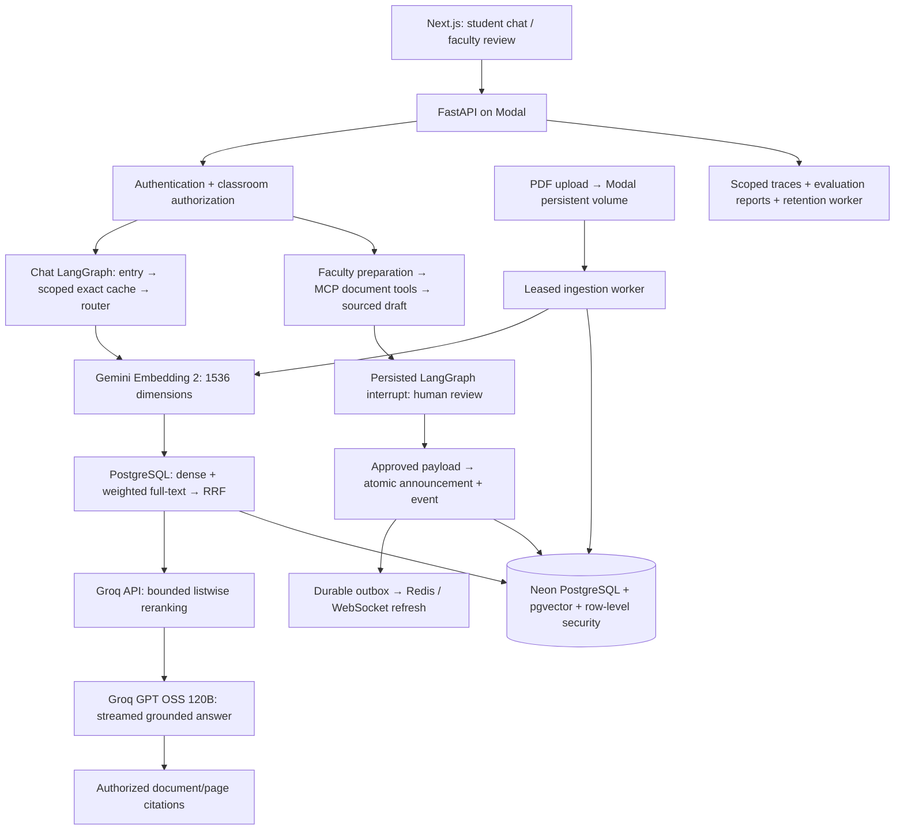

# CampusConnect interview demo

Open the [hosted application](https://yjoy1572--campusconnect-postgres-frontend-web.us-east.modal.run). Use your existing faculty and student accounts; credentials stay in the ignored local file.

## Five-minute walkthrough

1. **Student evidence (one minute).** Open the networking classroom, confirm its PDF is ready, and ask: “How do synchronous and statistical TDM allocate time slots?” Open a cited page and compare it with the answer. Suggested questions remain available without spending model quota.
2. **Retrieval comparison (one minute).** As faculty, open **Quality & Runs**, select the classroom, and compare dense, hybrid, and hybrid plus reranking. Inspect the returned passages and fallback status. Explain that weighted PostgreSQL full-text search is the lexical branch; do not call it BM25.
3. **An action with approval (two minutes).** In the classroom's revision-session panel, prepare a future session about a topic covered by the PDF. Inspect the citations and proposed announcement/event, edit if needed, then approve and post. Reload the panel and show its persisted status and created records. Replaying execution returns the original result.
4. **Operational evidence (one minute).** Follow **View execution trace** to show the linked workflow, MCP stages, and delivery activity. Switch the Quality overview to **Benchmarks** to inspect the saved evaluation. Explain provisional labels and provider fallbacks before discussing any score.

If free capacity is unavailable, show existing successful runs and the saved evaluation rather than repeatedly calling the provider. A fallback is part of the demonstration only when the UI/report identifies it accurately.

## Architecture to explain

The chat graph has entry, cache, router, embed, retriever, web, and reject nodes; answer streaming follows graph execution. Routing can also finish with a conversational response. The separate faculty graph has a review interrupt and approved-action execution. MCP is a tool protocol used by the workflow; exposing six tools does not mean there are six autonomous agents.

## Questions worth preparing

| Interview question | Defensible answer |
| --- | --- |
| Why PostgreSQL rather than MongoDB plus Chroma? | Users, memberships, revisions, workflow approvals, and actions need related constraints and transactions. pgvector and full-text search let the same authorized source of truth serve retrieval. Independent search infrastructure becomes justified by measured scale or capability requirements. |
| Why exact vector search first? | It is the correctness baseline at this corpus size. ANN requires its own recall and filtered-search evaluation; adding HNSW without that evidence would introduce another tradeoff. |
| Why hybrid search and reranking? | Lexical search helps exact terms; embeddings help paraphrases; RRF combines ranks; an API reranker selects evidence. Compare paired results and latency before claiming an improvement. |
| Why separate Gemini embeddings and Groq generation? | Provider adapters let retrieval and generation use different services. Embedding namespace, dimensionality, and preprocessing are versioned so incompatible vectors cannot mix. |
| Can the model publish an announcement by itself? | Preparation produces a draft. The server requires a recorded faculty approval bound to the exact version and payload hash before execution. Approval is absent from model-facing tools. |
| How do retries avoid duplicate actions? | PostgreSQL transactions, operation keys, payload binding, and persisted results protect domain writes. Outbox notifications can be delivered more than once; consumers refresh state. |
| How is tenant isolation enforced? | Current membership and role checks run at API/tool boundaries and through transaction-local identity with PostgreSQL row-level security. Source authorization is checked again before chat completion. |
| What did you train? | This project integrates foundation-model APIs and evaluates retrieval/workflows. It does not train or fine-tune a model. |
| How does this fit Atidan's JD? | RAG, FastAPI microservices, REST/SSE/WebSocket communication, LangGraph, MCP, provider integration, reranking, background pipelines, deployment, and monitoring are implemented. Microsoft/Azure integration and Airflow are not implemented. |

## Evidence and claim limits

The November 2 release passed all **106 backend tests** against a freshly migrated disposable database, plus the hosted browser check. Disposable test data was removed. The active resume URL above is unchanged.

The local SQL benchmark used 10,000 synthetic 1536-dimensional vectors, a three-connection pool, and five distinct authorized users. Hybrid search measured approximately **1.3 seconds p95** over 60 measured queries at concurrency five. This excludes HTTP, embedding, reranking, and generation, and establishes execution cost rather than semantic quality. The fixtures were removed afterward.

A prior live uncached networking answer completed in **6.657 seconds**, with **5.407 seconds to first token**; one cached request completed in **2.202 seconds**. These are individual observations, not latency percentiles or a service guarantee. Ten hosted authorization checks passed. A disposable Neon recovery rehearsal recovered a deleted marker and verified migration 012 while preserving application data.

The private evaluation contains 60 cases: 15 exact, 15 paraphrase, 10 multipassage, 10 absent-answer, and 10 scope checks, with 40 development / 20 held-out cases. Its labels need faculty review. Retrieval metrics do not establish answer correctness or citation faithfulness; review sampled generated answers with the separate rubric. Semantic answer caching remains disabled.

The completed provisional retrieval run scored 40 answerable questions and recorded 10 absent-answer questions separately. Mean nDCG@6 was 0.948 for dense retrieval, 0.922 for hybrid, and 0.925 for the reranking configuration; Recall@12 was 1.0 for all three on these provisional labels. The budget allowed actual reranking in 17 of 50 requests; 33 used a recorded fallback. The free-tier reranker reorders the first six of twelve candidates. These results establish neither a hybrid accuracy gain nor generalization to other courses. No automatic default tuning was performed against the held-out questions.

Answer trials exposed unsupported additions and a false out-of-scope rejection. The answer policy was revised to use supplied evidence, identify missing information, keep deductions explicit, and avoid unnecessary expansions. Routing now separates topic classification from answer availability, and cache identity includes the revised policy. Subsequent checks on those inspected cases are regression checks, not a fresh held-out accuracy test.

Six follow-up uncached trials completed: two each for the mesh formula, a multipassage multiplexing comparison, and an absent laboratory configuration. Agent review confirmed the core facts and both explicit missing-information responses. Responses can still be verbose, and full citation/label review remains pending with faculty. The live dashboard and related-activity links were checked in a real browser after release.

## Resume wording

- Built a classroom-scoped RAG application using FastAPI, LangGraph, PostgreSQL full-text search, pgvector, RRF, Gemini embeddings, and API-based reranking.
- Implemented authenticated MCP tools and a durable faculty approval workflow with payload-bound approvals, transactional actions, and retry-safe delivery.
- Added scoped operational traces, reproducible retrieval evaluations, provider quota controls, and Modal/Neon deployment with a verified isolated recovery rehearsal.

Keep percentage improvements, user-scale claims, and model-training claims out of the resume unless additional evidence establishes them.
