# CampusConnect

An AI learning platform with classroom-scoped document chat and faculty workflows that require human approval before posting.

**[Open the live application](https://yjoy1572--campusconnect-postgres-frontend-web.us-east.modal.run)**

Faculty upload course PDFs and manage classrooms. Enrolled students ask questions, receive streamed answers, and inspect cited document pages. Faculty can prepare a sourced revision-session announcement and calendar event, review and approve the draft, and inspect its execution trace.

## Current architecture

| Layer | Implementation |
| --- | --- |
| Frontend | Next.js, responsive student/faculty views, persistent light/dark themes, source previews, Quality & Runs dashboard |
| API | FastAPI, REST, SSE chat streaming, authenticated WebSockets |
| Chat workflow | Seven-node LangGraph with exact-cache lookup and conditional conversational/retrieval/web/out-of-scope routing |
| Retrieval | Gemini Embedding 2, 1536-dimensional pgvector search, weighted PostgreSQL full-text search, Reciprocal Rank Fusion |
| Text models | Groq `openai/gpt-oss-120b` for routing, generation, bounded reranking and faculty drafts |
| Tools and actions | Six authenticated MCP tools; separate durable LangGraph review/execute workflow |
| Persistence | Neon PostgreSQL, row-level security, revisioned chunks, payload-bound approvals, transactional actions and outbox |
| Background processing | Leased ingestion/delivery/cleanup jobs, bounded Modal workers, hourly rescue |
| Deployment | Modal API/frontend containers and persistent upload volume; managed PostgreSQL in Neon |
| Live updates | Redis Pub/Sub and classroom-authorized WebSockets |

Course answers use supplied evidence and acknowledge missing information. Exact-answer reuse checks the user, classroom, history, document revision, corpus version, and answer policy. Semantic reuse is disabled. Shared provider budgets preserve answer capacity; retrieval and reranking fallbacks are recorded explicitly.

Faculty approval is bound to the draft version and payload hash. Repeated execution returns the persisted result. Notification delivery can repeat; PostgreSQL protects the underlying domain actions.

## Student and faculty workflows

- **Students:** join a classroom, open ready course materials, ask follow-up questions, and inspect document/page citations. Chat supports streamed Markdown, tables, code blocks, and suggested questions.
- **Faculty:** upload PDFs, manage classroom announcements and events, prepare a sourced revision session, review the draft, and approve publication. Quality & Runs exposes retrieval comparisons and scoped execution traces.
- **Interface:** a neutral blue theme, compact controls, responsive navigation, and a light/dark toggle in the header and chat. The initial theme follows the device preference and saves explicit choices. Memoized message rendering and reduced animation limit unnecessary UI work; scrolling up during a response stops automatic scrolling.

### How a document question is answered

```mermaid
flowchart LR
    UI[Student question] --> API[FastAPI: identity and classroom access]
    API --> GRAPH[LangGraph: scoped cache and routing]
    GRAPH --> EMB[Gemini query embedding]
    EMB --> SEARCH[PostgreSQL full-text and vector search]
    SEARCH --> RRF[Reciprocal Rank Fusion]
    RRF --> RANK[Optional budget-aware LLM reranking]
    RANK --> ANSWER[Groq: grounded answer streamed over SSE]
    ANSWER --> SOURCES[Authorized document and page citations]
```



The seven chat nodes are `entry`, `cache`, `router`, `embed`, `retriever`, `web`, and `reject`. Conversation, cache hits, and rejected questions can bypass document retrieval. Answer generation streams after graph execution. PostgreSQL full-text search is the lexical branch, not BM25; vector search currently uses exact search rather than an ANN index.

### MCP and approved actions

The authenticated MCP server exposes `list_courses`, `search_documents`, `get_document`, `prepare_revision_session`, `get_workflow_status`, and `execute_approved_revision_session`. Tool calls enforce the caller's classroom access and role. These are tools, not six autonomous agents.

The faculty workflow searches authorized materials through MCP, creates a sourced draft, and pauses at a durable LangGraph review interrupt. Approval is a separate faculty UI/REST action, unavailable to model-facing tools. Execution creates the announcement and calendar event transactionally, with persisted results for safe retries and an outbox for subsequent notifications. Draft preparation skips optional reranking to preserve generation capacity; ordinary document search can still use it.

## Run and inspect

The active API entry point is `backend/postgres_main.py`. Configure a restricted runtime `DATABASE_URL`, Redis, a strong JWT secret, Groq credentials, and Gemini embedding credentials in the ignored environment file. Provision schemas and API/worker roles using [OPERATIONS.md](OPERATIONS.md).

```sh
cd backend
uv sync --frozen
uv run uvicorn postgres_main:app --reload --port 8000
```

```sh
cd frontend
npm ci
npm run dev
```

Before starting the frontend, create an ignored `frontend/.env.local` with the API origin and feature switches below. Next.js reads these public values at build time; never put API keys or database credentials in `NEXT_PUBLIC_*` variables.

```dotenv
NEXT_PUBLIC_API_URL=http://localhost:8000
NEXT_PUBLIC_WS_URL=ws://localhost:8000
NEXT_PUBLIC_FACULTY_WORKFLOWS=true
NEXT_PUBLIC_QUALITY_DASHBOARD=true
NEXT_PUBLIC_DEMO_ENABLED=false
```

Local PostgreSQL is available through `docker compose -f compose.postgres.yml up -d --wait`. Hosted ingestion and delivery use `backend/modal_staging.py`. The older MongoDB/Chroma/Celery entry points and compose files remain legacy code, separate from the deployed PostgreSQL application.

The frontend deploys through `frontend/modal_staging.py`, with `CAMPUS_STAGING_API_URL` set to the deployed HTTPS backend origin. Modal runs the application containers and persistent upload volume; Neon hosts PostgreSQL. See [OPERATIONS.md](OPERATIONS.md) for deployment commands and migration requirements.

## Verification and evaluation

Tests cover restricted-role API/database access, MCP authorization, ingestion/revision/cache behaviour, approval/retry recovery, and correlated workflow/background tracing. Operational verification includes 10,000-chunk local retrieval, five concurrent scoped principals, isolated Modal startup probes, and a disposable Neon point-in-time recovery rehearsal.

The UI release passed a production build and hosted browser checks for both student and faculty views, theme persistence, device dark-mode preference, mobile navigation, chat tables/lists, and streaming scroll behaviour. Browser checks used synthetic API responses; they complement the separate backend and live-provider checks.

The private evaluation contains 60 cases. Fifty retrieval comparisons and ten hosted authorization checks are recorded; source labels require faculty review. Provisional results on the networking PDF favour dense retrieval, so no hybrid accuracy improvement is claimed. Budget fallbacks and sampled answer regressions are reported separately from retrieval scores.

- [Interview walkthrough and measured claim limits](INTERVIEW_DEMO.md)
- [Deployment, tests, quotas, retention and recovery](OPERATIONS.md)

Private source excerpts, credentials, generated-answer reports, and the local implementation plan are excluded from Git.
